<div align="center">

<a href="https://celestia-website.onrender.com">
  
</a>

<br/>

<a href="https://celestia-website.onrender.com"></a>
<a href="https://github.com/priyanshusharan-cmd/celestia/releases/latest"></a>
<a href="https://github.com/priyanshusharan-cmd/celestia/actions/workflows/container-check.yml"></a>
<a href="./LICENSE"></a>


<h3>
  <a href="https://celestia-website.onrender.com">Live Lab</a>
  <span>&nbsp;·&nbsp;</span>
  <a href="#demo">Demo</a>
  <span>&nbsp;·&nbsp;</span>
  <a href="#architecture">Architecture</a>
  <span>&nbsp;·&nbsp;</span>
  <a href="#physics">Physics</a>
  <span>&nbsp;·&nbsp;</span>
  <a href="#quick-start">Quick Start</a>
  <span>&nbsp;·&nbsp;</span>
  <a href="https://github.com/priyanshusharan-cmd/celestia/releases/latest">Download</a>
</h3>

</div>

<br/>

<table>
<tr>
<td>

**Celestia** is an interactive orbital dynamics laboratory for the **Circular Restricted Three-Body Problem (CR3BP)**.
Pick two bodies, solve for all five Lagrange points, nudge a satellite off its equilibrium,
and watch a high-accuracy **REBOUND / IAS15** integration show you whether it stays or escapes,
in the rotating frame, with live telemetry, and as a cinematic MP4.

</td>
</tr>
</table>

<div align="center">

> Most demos stop at *"Where are the Lagrange points?"*<br/>
> **Celestia asks: "What happens when we disturb a satellite at one of them?"**

</div>


<a id="demo"></a>

## 🎥 Demonstration

<div align="center">
  <video src="https://github.com/user-attachments/assets/5e6ecf11-f7f7-44ba-a35e-475ac50cb04f" width="90%" controls autoplay loop muted></video>
  <br/>
  <sub>System configuration → numerical simulation → rotating-frame view → telemetry → cinematic render</sub>
</div>


## ✨ What it does

<table>
<tr>
<td width="33%" valign="top">

### 🪐 Configure
Choose any pair from a built-in catalogue (Sun to Pluto) or place **custom bodies** directly on the orbital map. The mass ratio `μ` is derived live.

</td>
<td width="33%" valign="top">

### 📍 Solve
All five **Lagrange points** are computed for your `μ`: root-finding for L1–L3 and the exact equilateral solution for L4/L5.

</td>
<td width="33%" valign="top">

### 🧭 Classify
Each equilibrium is **linearised** and its eigenvalues decide the verdict. Nothing is hard-coded as "stable".

</td>
</tr>
<tr>
<td width="33%" valign="top">

### 🚀 Perturb
Push the satellite **in/out**, **sideways**, or trim its **velocity**, then integrate with REBOUND's adaptive **IAS15**.

</td>
<td width="33%" valign="top">

### 🌌 Visualise
Explore the 2D orbital plane, a 3D **effective-potential terrain**, and a cinematic Plotly orbit with playback.

</td>
<td width="33%" valign="top">

### 🎬 Export
Render the same trajectory as a **Manim** animation and download it as an MP4.

</td>
</tr>
</table>


<a id="architecture"></a>

## 🛰️ Architecture

<div align="center">
  
</div>

<br/>

Every view is generated from the **same numerical trajectory**: the cinematic render and the scientific plot never disagree.

| Module | Role | Key pieces |
| :-- | :-- | :-- |
| [`app.py`](./app.py) | Streamlit mission control: inputs, state, telemetry, video export | body catalogue, cached trajectory, export dialog |
| [`physics.py`](./physics.py) | CR3BP mathematics | `mass_ratio`, `all_lagrange_points`, `stability`, `jacobi_constant` |
| [`rebound_sim.py`](./rebound_sim.py) | Numerical dynamics | `build_simulation`, `add_satellite`, `run_and_record` (IAS15, escape guard) |
| [`frames.py`](./frames.py) | Reference frames | `to_rotating_frame`, vectorised inertial → rotating rotation |
| [`viz.py`](./viz.py) | Interactive Plotly figures | `system_figure`, `potential_terrain_figure`, `cinematic_orbit_figure` |
| [`manim_viz.py`](./manim_viz.py) | Cinematic pipeline | `OrbitalScene`, `render_trajectory` → MP4 |


<a id="physics"></a>

## 🔭 The Physics

Celestia models two primaries `m₁`, `m₂` in circular orbit around their barycentre, plus a **massless** satellite that feels both but moves neither.

<table>
<tr>
<td width="50%" valign="top">

**Mass ratio and geometry**

```math
\mu = \frac{m_2}{m_1 + m_2}, \qquad x_1 = -\mu, \qquad x_2 = 1-\mu
```

**Effective potential (rotating frame)**

```math
\Omega(x,y) = \frac{1-\mu}{r_1} + \frac{\mu}{r_2} + \frac{x^2+y^2}{2}
```

</td>
<td width="50%" valign="top">

**Triangular points (exact)**

```math
L_{4,5} = \left(\tfrac{1}{2}-\mu,\ \pm\tfrac{\sqrt{3}}{2}\right)
```

**Jacobi constant**

```math
C = 2\,\Omega(x,y) - \left(v_x^2 + v_y^2\right)
```

</td>
</tr>
</table>

#### 📍 Collinear points L1, L2, L3

The collinear points are roots of the equilibrium condition on the x-axis:

```math
x - (1-\mu)\frac{x+\mu}{|x+\mu|^3} - \mu\frac{x-1+\mu}{|x-1+\mu|^3} = 0
```

`physics.py` brackets each root and solves it with `scipy.optimize.brentq`, falling back to Newton's method:

- **L1** lies between the two primaries
- **L2** lies beyond the secondary
- **L3** lies beyond the primary, on the far side

with $r_1=\sqrt{(x+\mu)^2+y^2}$ and $r_2=\sqrt{(x-1+\mu)^2+y^2}$.

#### 🧭 Linear stability analysis

The Hessian of $\Omega$ at the chosen point ($\Omega_{xx}$, $\Omega_{yy}$, $\Omega_{xy}$) is estimated with central finite differences and placed in the linearised rotating-frame system:

```math
A = \begin{bmatrix} 0&0&1&0\\ 0&0&0&1\\ \Omega_{xx}&\Omega_{xy}&0&2\\ \Omega_{xy}&\Omega_{yy}&-2&0 \end{bmatrix}
```

If any eigenvalue of $A$ has a positive real part, the point is **unstable**; otherwise it is **stable**.
For Earth–Moon (`μ ≈ 0.01215`) that yields L1–L3 unstable and L4/L5 stable. The animated banner above shows exactly this: a real tadpole libration around L4 and a real departure from L1.

#### 🧮 Numerical integration with REBOUND / IAS15

```python
sim = rebound.Simulation()
sim.G = physics.GRAVITATIONAL_CONSTANT   # 4π² / 332 946  →  AU³ / (M⊕ · yr²)
sim.integrator = "ias15"
```

The primaries start on circular orbits about the barycentre and the satellite is added with `m = 0.0`, exactly as the restricted problem requires.
Units are **AU, Earth masses and years**, so the Earth–Sun period comes out as one year (covered by the test suite).
**IAS15** is adaptive and accurate to machine precision, which matters when the whole experiment is about the response to *small* changes in the initial state.
Integration stops early if the satellite leaves the map (`escape_radius`).

#### 🔄 Inertial → rotating frame

REBOUND evolves the system in an inertial frame, but Lagrange points are only stationary in the frame co-rotating with the primaries. With $\theta = \omega t$:

```math
x_r = x\cos\theta + y\sin\theta, \qquad y_r = -x\sin\theta + y\cos\theta
```

`frames.py` applies this to the whole trajectory with vectorised NumPy.


## 🧪 Run an experiment

<table>
<tr><th>Step</th><th>You</th><th>Celestia</th></tr>
<tr><td><code>01</code></td><td>Pick <b>Earth</b> and <b>Moon</b></td><td>Derives <code>μ ≈ 0.01215</code> and the orbital period</td></tr>
<tr><td><code>02</code></td><td>Select <b>L4</b></td><td>Solves all five points and reports the stability verdict</td></tr>
<tr><td><code>03</code></td><td>Leave perturbations near zero</td><td>The satellite sits still in the rotating frame</td></tr>
<tr><td><code>04</code></td><td>Nudge <b>in/out</b>, <b>sideways</b> or <b>velocity</b></td><td>Integrates with IAS15 and transforms to the rotating frame</td></tr>
<tr><td><code>05</code></td><td>Repeat at <b>L1, L2, L3, L5</b></td><td>Compare libration against escape</td></tr>
<tr><td><code>06</code></td><td>Open the 3D terrain or export</td><td>Shows the potential landscape or renders an MP4</td></tr>
</table>

**Telemetry reported for every run**

| Metric | Meaning |
| :-- | :-- |
| **Maximum deviation** | Largest displacement of the trajectory from its starting point |
| **Jacobi constant** | Conserved rotating-frame quantity, $C = 2\Omega - v^2$ |
| **Mass ratio μ** | Secondary-to-total mass ratio |
| **Orbital period** | Period of the two primaries from their total mass and separation |

<sub>🪐 Body catalogue: Sun · Mercury · Venus · Earth · Moon · Mars · Jupiter · Saturn · Uranus · Neptune · Pluto · Custom</sub>


<a id="quick-start"></a>

## 🚀 Quick Start

<table>
<tr>
<td width="33%" valign="top">

### 🌐 In the browser
No install. Open the hosted lab:

**[celestia-website.onrender.com](https://celestia-website.onrender.com)**

<sub>Free hosting: the first load can take ~30 s to wake up.</sub>

</td>
<td width="33%" valign="top">

### 💻 Desktop app
No Python needed. Grab the build for your OS from **[Releases](https://github.com/priyanshusharan-cmd/celestia/releases/latest)**:

- `Celestia-Windows.exe`
- `Celestia-macOS`

<sub>macOS: right-click → Open the first time, or <code>chmod +x Celestia-macOS</code>.</sub>

</td>
<td width="33%" valign="top">

### 🐳 Docker
```bash
docker build -t celestia .
docker run -p 8501:8501 celestia
```
Then open `localhost:8501`.

</td>
</tr>
</table>

**From source** (Python 3.11 and FFmpeg; FFmpeg is needed for the cinematic export)

```bash
git clone https://github.com/priyanshusharan-cmd/celestia.git
cd celestia
pip install -r requirements.txt
streamlit run app.py
```

**Tests**

```bash
python -m unittest discover tests
```

<details>
<summary><b>📁 Repository layout</b></summary>

```text
celestia/
├── app.py              Streamlit UI, state, telemetry, video export
├── physics.py          CR3BP maths, Lagrange solvers, stability, Jacobi constant
├── rebound_sim.py      REBOUND / IAS15 integration
├── frames.py           Inertial → rotating transformation
├── viz.py              Plotly 2D plane, 3D potential terrain, cinematic orbit
├── manim_viz.py        Manim scene and MP4 rendering
├── run_app.py          Desktop entry point
├── build.py            PyInstaller build script
├── tests/              Physics, frame and simulation tests
├── Dockerfile          Production image (Render)
├── .github/workflows/  Container check and desktop release builds
└── assets/readme/      Animated README artwork
```

</details>


## ⚠️ Scientific scope

Celestia is a **scientific simulation and teaching laboratory**, not a flight-certified mission-design tool. The CR3BP assumes:

`circular primary orbits` · `point masses` · `massless satellite` · `no relativity` · `no drag` · `no solar radiation pressure` · `no ephemerides`

Real mission planning needs higher-fidelity ephemerides and perturbation models.

## 🧠 Design philosophy

1. **Physics first.** Every animation is generated from the numerical model, never decoration.
2. **Experiment over observation.** Disturb the equilibrium and see what the dynamics do.
3. **Scientific computing should be beautiful.** Rigorous maths behind a mission-control interface.

## 🗺️ Roadmap

- [x] Dynamic Lagrange solver for any mass ratio
- [x] Eigenvalue stability classification
- [x] REBOUND / IAS15 integration with rotating-frame transform
- [x] 2D, 3D and cinematic visualisation with MP4 export
- [x] Hosted web app and Windows / macOS desktop builds
- [ ] Zero-velocity surfaces and automated stability maps
- [ ] Halo and Lissajous orbit families
- [ ] Elliptic restricted problem and 3D spatial trajectories
- [ ] Solar radiation pressure and drag models
- [ ] Δv budgets, Lambert transfers and mission presets


<div align="center">



### Explore the equilibria. Disturb the system. Understand the orbit.

Built for **Singularity, the Astronomical Society of BMSCE**<br/>
as a submission to the **Cosmic Code Hackathon 2026**

<sub>Python · NumPy · SciPy · REBOUND · Plotly · Streamlit · Manim</sub>

<br/><br/>

Made by **Priyanshu Sharan**

<a href="https://github.com/priyanshusharan-cmd"></a>
<a href="https://www.linkedin.com/in/priyanshusharan/"></a>

<sub>Released under the <a href="./LICENSE">MIT License</a>.</sub>

</div>
